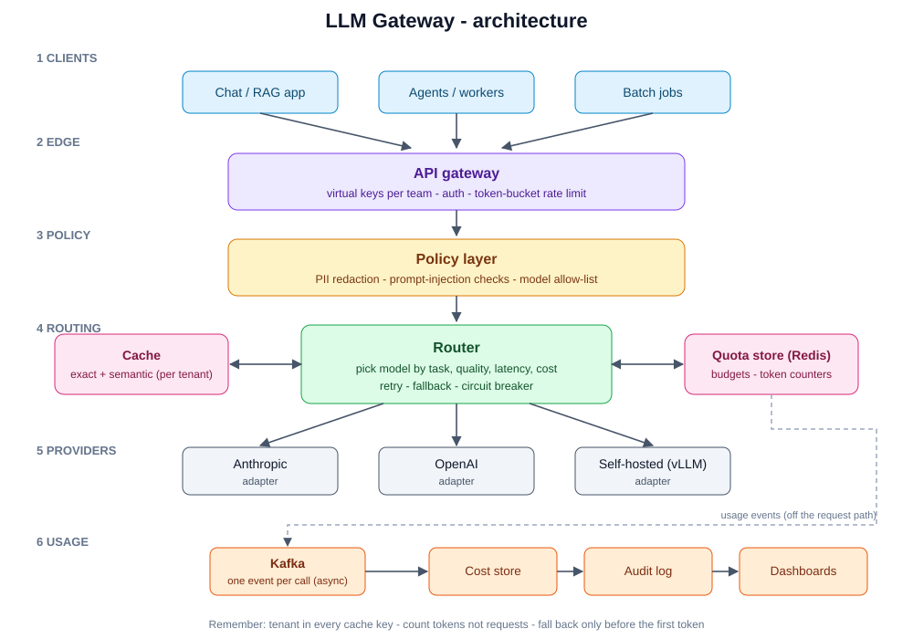

# Design: LLM Gateway

Studied: 2026-10-27 · Plan link: system-design bank item 10 (Week 8) · Status: learned once, to re-run in Week 8 and Week 9 mocks

## One-line summary
One internal service that every app calls for LLMs, giving central keys, quotas, routing, caching, policy and cost reporting.

## Requirements
- **Functional:** one API over many providers, streaming, per-team keys and budgets, routing and fallback, caching, PII redaction, usage and cost reports.
- **Non-functional:** under 50 ms overhead, 99.9% availability, no single point of failure, retention rules for prompts and responses.
- **Out of scope:** model training, prompt authoring.

## Numbers (practice scale)
200 apps · 5,000 req/s peak · ~1,500 in / 500 out tokens per request · streams last 5–30 s → ~150,000 concurrent connections at peak. Cost, not CPU, is the main constraint.

## Request flow
1. Client calls the gateway with a team **virtual key**.
2. Gateway authenticates, checks the **token-bucket** rate limit and budget.
3. **Policy layer** redacts PII, checks for prompt injection, and checks the model allow-list.
4. **Cache** lookup (exact first; semantic only for low-risk use, with tenant in the key).
5. **Router** chooses the model (task, quality, latency, cost), calls the provider adapter, retries and falls back with a circuit breaker.
6. Response streams back. The real token count settles the quota (an estimate was reserved up front).
7. A usage event goes to Kafka asynchronously, feeding cost, audit and dashboards.

## Components at a glance
| Component | Job | Key detail |
|-----------|-----|-----------|
| API gateway | Auth, virtual keys, rate limits | Real provider keys never leave the gateway |
| Policy layer | PII, injection, allow-list | Fail closed for sensitive tenants |
| Cache | Cut cost and latency | Tenant in key; semantic cache with high threshold |
| Router | Pick model, retry, fall back | Circuit breaker; fall back only before first token |
| Quota store (Redis) | Budgets and counters | Reserve estimate, settle actual |
| Provider adapters | Normalize provider APIs | Keeps you provider-neutral |
| Kafka pipeline | Usage, cost, audit | Off the request path |

## Deep dives (be ready)
1. **Streaming failover:** you can't switch provider after tokens are sent. Fall back before the first token, or buffer the first chunk.
2. **Retries:** retry only safe calls. A call that triggered a tool action must not be replayed blindly.
3. **Quota accounting:** output tokens are unknown until the end, so reserve then settle.
4. **Multi-tenancy:** a cached answer must never cross tenants.
5. **Observability:** trace model, tokens, latency, cache hit, retries; alert on error rate, p95 and spend per team.

## Failure modes
- Provider outage → circuit breaker, fallback.
- Runaway agent spending → per-key hard budget plus alert.
- Redis down → fail closed for expensive models, open for cheap ones.
- Secrets or PII in prompts → redaction and a logging policy.

## Trade-offs
- Build vs buy: start with an existing gateway such as LiteLLM or a managed one; build only for custom policy, compliance or tenancy.
- Central gateway vs shared client library: control and audit vs an extra hop and a single dependency.
- Provider-neutral adapters vs losing provider-specific features.

## Self-test (answer aloud)
1. Why count tokens, not requests, for rate limits?
2. When is a semantic cache a bad idea?
3. What happens to a streaming request when the primary provider dies mid-response?
4. How do you stop one runaway agent spending the monthly budget in an hour?

## My own experience to connect (fill in only what's true)
- Where did I see this problem? (e.g. agents calling LLMs without central cost control)
- What did I build or decide, and what was the measured result?

## Log
| Date | Activity | Notes |
|------|----------|-------|
| 2026-10-27 | First read + diagram | |
